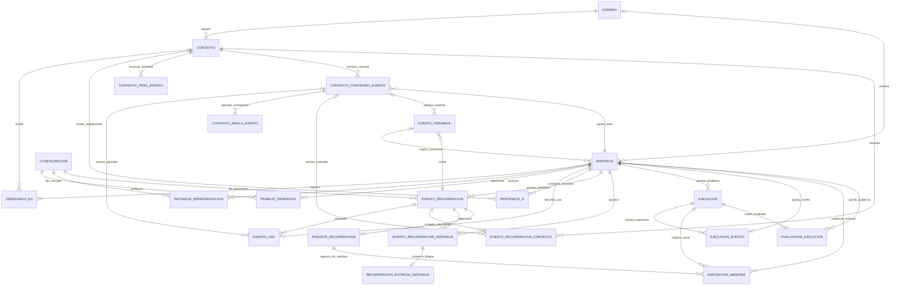
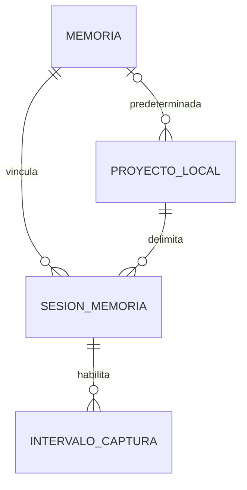
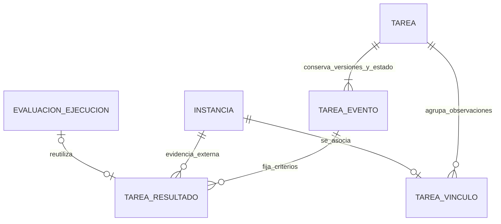

# Memoria persistente v1 — ERD, modelo lógico y propuesta física

Actualizado: 2026-09-16. Stack decidido: **Rust + SQLite; CTEs recursivas solo para recorridos que las necesiten**. El mecanismo se especifica en [Aprendizaje por casos y resultados](mecanismo-aprendizaje-v1.md).

**Estado:** tandas 1–4 implementadas: captura, recuperación textual, trayectoria/evaluación externa e integración Claude Code con memorias por sesión/proyecto. La prueba nativa de tanda 4 fue informada por el usuario; no demuestra aprendizaje. Los bloques SQL de secciones 4–5 conservan la base de `codigo/migrations/001_erd.sql`; las migraciones de contenido implementadas llegan a 005 y el registro de control tiene su propia 001. La sección 9 especifica la tanda 5 pendiente: instrumentación de tareas y evaluación del beneficio de memoria acumulada. No ejecutar los bloques sobre bases existentes ni editar migraciones aplicadas. Ver [plan y prompt de tanda 5](prompt-tanda-5.md).

## 1. Decisiones y alcance

- El historial crudo es permanente e independiente de la cola recuperable de procesamiento. Se confirma recepción solo después del commit local.
- Learning by using: conservar resultado y trayectoria de uso (intentos, ajustes, pruebas y recursos), sin reducirlos prematuramente a un puntaje único.
- Se registra todo evento disponible para la integración dentro de los intervalos habilitados explícitamente por el usuario. Apagar la memoria suspende captura y recuperación; no se importa después lo ocurrido durante la pausa. Ninguna LLM ni detector de novedad decide qué conservar. Si una fuente no expone un evento, el sistema no puede inventarlo.
- Encoder semántico fijo para representar similitud; aprendizaje numérico sobre recurrencia y resultados observables. BGE-M3 es el candidato a medir, sin descarga ni instalación en esta etapa.
- Se distinguen **recurrencia/accesibilidad**, **utilidad comprobada** y **condiciones de aplicación**. `w_i` ya no pretende representar las tres cosas ni una energía física.
- Las correcciones pueden revisar una solución, originar otra o quedar pendientes. Una falla fiable aporta evidencia; no liquida automáticamente.
- Candidatos evaluados e inyectados se registran por separado mediante flag. La co-ocurrencia es evidencia de relación, no equivalencia ni autorización para fusionar dominios.
- Historial de asignaciones, contenido, reglas y cambios de peso. Se registra la versión y el texto realmente inyectados.
- La v1 aprende asociaciones y condiciones entre rasgos disponibles y resultados. Su cercanía al Aprendizaje II se evalúa por transferencia a casos nuevos, no por tener nuevas tablas o etiquetas.

## 2. Modelo conceptual



## 3. Modelo lógico e invariantes

### Eventos, representación y episodios independientes

`instancia` conserva contenido crudo de usuario, herramienta, modelo o replay, rol técnico de la fuente, clave idempotente y grupo de evidencia. Incluye respuestas ordinarias y correcciones; el contenido no se limita a las semillas. El grupo enlaza los eventos de un mismo episodio y evita contar diez mensajes como diez resultados independientes.

Cada evento se inserta junto con al menos una `observado_en`; contexto y score pueden ser NULL al ingresar. Cuando se conoce la asociación se agrega otra observación. La recurrencia se calcula por grupos de evidencia, no por filas de observación. Las reiteraciones generadas por el propio modelo o por replay no refuerzan recurrencia externa.

La representación se calcula después de guardar y se inserta en `instancia_representacion`. Configuración identifica encoder, revisión/hash, normalización, segmentación, extracción de rasgos y semilla. Un embedding es un vector, no un juicio de verdad. No se comparan vectores de configuraciones incompatibles. `novedad_score` es una anotación; NULL significa pendiente. Los rasgos del problema solo usan información disponible antes de la respuesta.

### Captura durable y cola recuperable

`instancia.contenido` conserva el contenido completo recibido; `metadatos_json` conserva el sobre de origen (plataforma, proyecto, sesión, tipo de evento, ID de llamada, secuencia y estado de completitud cuando existan). Para herramientas, se preservan entrada y salida originales, incluidos fallos e interrupciones. No se aplica resumen ni truncamiento semántico al historial; los límites de captura impuestos por la fuente quedan indicados, no se presentan como datos íntegros. Solo se puede registrar aquello que la integración entrega.

Una transacción inserta instancia, observación inicial y `trabajo_pendiente`. La confirmación al capturador ocurre después del commit; un envío HTTP sin confirmación no equivale a persistencia. Si falla el almacenamiento, la fuente debe retener el evento y reintentar o permitir relectura del transcript desde un cursor durable. Sin esa capacidad no se promete captura sin pérdidas. Las claves de evento incluyen plataforma/sesión/ID de origen para evitar colisiones. Un reenvío idéntico devuelve el ID existente; misma clave con contenido distinto es un conflicto explícito, nunca una sobrescritura silenciosa.

La cola contiene referencias al historial, no su única copia. Es estado operativo mutable: pendiente, en proceso, completado o fallido. La v1 conserva filas completadas; consumir una tarea significa marcarla, no borrar el evento. El worker reclama una tarea en una transacción corta con token y vencimiento de reserva, calcula fuera de la transacción y confirma el resultado derivado y la finalización juntos. Solo el poseedor del token vigente puede finalizar; una reserva vencida puede recuperarse. El resultado también usa su clave idempotente, porque la entrega es al menos una vez y no ejecución exactamente una vez.

Fallos transitorios reprograman `disponible_desde` con espera creciente; fallos persistentes conservan tarea y error para reanudación. No se borra el evento tras agotar reintentos. Una nueva configuración crea otro trabajo sin modificar la representación previa. Las dependencias entre etapas se habilitan cuando termina su predecesora; los embeddings/EMA se aplican en orden de fuente dentro del flujo, no por orden de finalización del worker.

### Trayectoria de uso: learning by using

`evento_uso` enlaza un evento crudo con un intento real de aplicación. `intento_clave` agrupa inicio, pruebas, ajustes y resultado; no es la clave idempotente del evento ni el grupo de episodios independientes. Puede existir sin recuperación previa: también se aprende de una solución usada por primera vez. `contenido_id` identifica una versión aplicada solo cuando la fuente permite determinarla; con varias memorias presentes y atribución desconocida queda NULL.

Si se conoce tanto recuperación como versión, debe ser una versión inyectada allí. La aplicación valida además la evidencia de uso específico; exposición no basta. Una prueba ejecutada o una llamada que termina sin error no se convierten automáticamente en éxito de toda la tarea. `evento_feedback` mantiene el juicio externo bajo su criterio; `evento_uso` aporta la secuencia que lo sustenta, sin duplicar votos de éxito.

`metricas_json` conserva medidas con nombre, valor, unidad, alcance y método cuando están disponibles: duración del intento, tokens de entrada/salida, llamadas, recursos y referencia de prueba. Valores desconocidos se omiten o quedan NULL, nunca cero. Los conteos de reintentos, correcciones y pruebas se derivan de eventos/IDs de operación distintos. No se suman duraciones solapadas como si fueran tiempo total, ni medidas acumuladas como si fueran incrementos.

La primera versión aprende éxito/fallo bajo un criterio externo y conserva por separado esfuerzo y ajustes. Un resultado exitoso tras tres correcciones sigue siendo éxito con tres correcciones; no se convierte arbitrariamente en fracaso ni en tres éxitos. Comparar eficiencia requiere resultado y condiciones semejantes (tarea, tamaño de entrada, herramientas/entorno y criterio). Cambios de requisitos se registran cuando la fuente los identifica; no se etiquetan como defectos de la solución por mera cercanía temporal. Los resultados y costos posteriores jamás se filtran a los rasgos previos de ese mismo problema.

### Candidatos, dominios y contenido inyectado

Se registran todos los contextos puntuados, incluida la fase gruesa. `evaluado_detalle` indica cuáles entraron al análisis de utilidad. Esto evita llamar candidatos solo a los top-K. El costo del log crece con la cantidad evaluada; no se promete O(1) por recuperación.

`dominio.proyecto` limita el espacio de búsqueda de la integración, no define una taxonomía cognitiva. Contextos nuevos sin antecedente nacen en dominios singleton. Una corrección hereda dominio solo cuando apunta explícitamente a una versión del contexto corregido. Una recuperación con varios inyectados no determina cuál falló. La v1 no fusiona dominios por componentes conexos de co-ocurrencia; evita así confundir complementariedad con sustituibilidad. Se permite recuperar de varios dominios del mismo proyecto, sin migrar automáticamente sus instancias entre sí.

Cada inyección de una versión general guarda `contenido_id`, `orden_inyeccion` y `texto_inyectado` exacto, incluso si se recortó la versión original. Las reglas activa y en sombra y sus predicciones quedan fijadas antes de conocer el resultado. Para los paquetes episódicos implementados, la selección solo prueba preparación local; la exposición y las salidas se enlazan mediante los registros adicionales de la sección 7, sin modificar la recuperación sellada.

### Feedback y utilidad

Feedback tiene fuente externa (`usuario_explicito` o `verificador_externo`), resultado 0/1 opcional y versión objetivo opcional. Un mensaje libre no se convierte en éxito o fallo mediante un juez LLM. La integración recoge una confirmación/corrección explícita o un resultado de un verificador determinista con alcance definido.

La FK y un trigger impiden apuntar como objetivo a una versión no inyectada. La aplicación exige además evidencia de aplicación o evaluación específica: estar en el prompt no prueba uso ni causalidad. Feedback sin objetivo se conserva a nivel respuesta, pero no se reparte como premio/castigo entre todos los inyectados. Una corrección puede tener resultado NULL si no determina éxito/fallo.

Se cuenta como máximo un resultado por `(grupo_evidencia, contenido_objetivo_id, clave_evaluacion)`. Reintentos conservan clave de evento. Evaluaciones contradictorias del mismo grupo/version/criterio se excluyen de entrenamiento hasta resolverlas; no se cuentan como ensayos independientes. Criterios distintos tampoco se suman como ensayos extra del mismo episodio: la configuración fija el criterio objetivo del modelo. No se entrenan con casos sin resultado conocido.

### Pertenencia, contenido y reglas

`pertenece_a` conserva SCD tipo 2 con final derivado por LEAD: intervalo `[vigente_desde, siguiente_inicio)`. Se exige inicio creciente por instancia; antes del primero no hay asignación. No se insertan vigencias futuras ni retroactivas. Los timestamps son microsegundos UTC; el escritor serializa colisiones. Este historial clasifica episodios; no reemplaza la regla que decide cuándo aplicar una solución a problemas futuros.

El contenido usa snapshots completos y la vista toma la última versión, no suma textos. Los contextos nacen provisionales y se activan con evidencia; cambiar el contenido devuelve el contexto a provisional en la misma transacción. Cada versión conserva la instancia que aporta su texto; una revisión enlaza la versión anterior del mismo contexto. En v1 se conserva una solución efectivamente observada como representante. El motor no inventa una síntesis verbal universal: aprende cuándo recuperar ese representante. Una futura LLM podría redactar una propuesta, pero eso no sería evidencia ni autorización para promoverla.

`contexto_regla_evento` conserva un árbol pequeño de condiciones y probabilidades, con configuración y manifiesto de evidencia. Propuestas y rechazos no alteran la regla vigente; el rechazo agrega un snapshot con evidencia y referencia a la propuesta. Activar/restaurar agrega una fila con snapshot completo y referencia a la propuesta/origen. Las probabilidades y conteos se congelan dentro del snapshot para verificar predicciones históricas. Al cambiar contenido se reinicia la estimación de utilidad de esa versión: no hereda automáticamente los éxitos del texto anterior.

El manifiesto `evidencia_json` incluye IDs de feedback y grupos de entrenamiento/validación, cortes temporales, métricas de referencia/propuesta, razón y versión del algoritmo. El escritor valida estas referencias: ser JSON válido no garantiza integridad de su contenido. La v1 conserva esas listas auditables sin añadir otra red de tablas de entrenamiento.

### Peso y liquidación

`contexto_peso_evento` registra accesibilidad por recurrencia y fuga; `peso_actual = SUM(delta)`, partiendo de cero. Cada cambio tiene clave idempotente, configuración y evidencia opcional. La utilidad se calcula aparte con resultados de la versión bajo la condición aprendida. Frecuencia y éxito no se sustituyen entre sí.

Fuga aplicada de forma diferida: en un ciclo de consolidación, `delta = w_previo * (2^(-dias_transcurridos/30) - 1)`. Luego se registra +1 por cada episodio externo nuevo asociado, una sola vez. Cada paso usa tiempo de aplicación monotónico y una clave que impide duplicar un intervalo. El ledger reconstruye pesos realmente aplicados; no declara estados intermedios que nunca se materializaron.

Un contexto archivado sigue existiendo y es recuperable por consulta histórica. Bajo peso por desuso lo saca de propuestas proactivas; no convierte una solución rara en falsa. No hay liquidación ni migración automática solo por comparación de pesos. Una sustitución requiere destino explícito y evidencia de aplicabilidad/resultado; si la v1 no puede comprobarla, conserva ambos. Cuando se ejecuta, inserta `motivo='liquidacion'`, nuevas vigencias y cambio de estado en la misma transacción. No precisa tabla especial de liquidaciones.

## 4. Propuesta física — SQLite

Se mantienen TEXT inline y una sola base local. El Rust del motor controla transacciones y cálculos; CTEs puntuales para recorridos, joins/ventanas para el resto. No se instala un motor de grafos ni se presupone una extensión vectorial.

```sql
PRAGMA foreign_keys = ON;

CREATE TABLE configuracion (
    id INTEGER PRIMARY KEY,
    timestamp INTEGER NOT NULL,
    parametros_json TEXT NOT NULL CHECK (json_valid(parametros_json))
);
CREATE TABLE dominio (id INTEGER PRIMARY KEY, proyecto TEXT NOT NULL);
CREATE TABLE contexto (
    id INTEGER PRIMARY KEY,
    dominio_id INTEGER NOT NULL REFERENCES dominio(id),
    estado TEXT NOT NULL DEFAULT 'provisional' CHECK (estado IN ('provisional', 'activo', 'archivado')),
    fecha_creacion INTEGER NOT NULL,
    fecha_actualizacion INTEGER NOT NULL
);
CREATE TABLE instancia (
    id INTEGER PRIMARY KEY,
    dominio_id INTEGER REFERENCES dominio(id),
    clave_evento TEXT NOT NULL UNIQUE,
    grupo_evidencia TEXT NOT NULL,
    origen TEXT NOT NULL CHECK (origen IN ('usuario', 'herramienta', 'modelo', 'replay')),
    rol TEXT NOT NULL CHECK (rol IN ('problema', 'solucion', 'correccion', 'otro')),
    contenido TEXT NOT NULL,
    metadatos_json TEXT NOT NULL DEFAULT '{}' CHECK (json_valid(metadatos_json)),
    origen_feedback_id INTEGER REFERENCES evento_feedback(id), -- referencia adelantada: evento_feedback se declara más abajo; SQLite no exige orden
    timestamp INTEGER NOT NULL
);
CREATE TABLE trabajo_pendiente (
    id INTEGER PRIMARY KEY,
    instancia_id INTEGER NOT NULL REFERENCES instancia(id),
    configuracion_id INTEGER NOT NULL REFERENCES configuracion(id),
    etapa TEXT NOT NULL,
    estado TEXT NOT NULL DEFAULT 'pendiente'
        CHECK (estado IN ('pendiente', 'en_proceso', 'completado', 'fallido')),
    intentos INTEGER NOT NULL DEFAULT 0 CHECK (intentos >= 0),
    disponible_desde INTEGER NOT NULL,
    reserva_token TEXT,
    reserva_hasta INTEGER,
    ultimo_error TEXT,
    CHECK ((estado = 'en_proceso' AND reserva_token IS NOT NULL AND reserva_hasta IS NOT NULL)
        OR (estado <> 'en_proceso' AND reserva_token IS NULL AND reserva_hasta IS NULL)),
    UNIQUE (instancia_id, configuracion_id, etapa)
);
CREATE TABLE instancia_representacion (
    id INTEGER PRIMARY KEY,
    instancia_id INTEGER NOT NULL REFERENCES instancia(id),
    configuracion_id INTEGER NOT NULL REFERENCES configuracion(id),
    embedding BLOB,
    rasgos_json TEXT NOT NULL CHECK (json_valid(rasgos_json)),
    novedad_score REAL,
    timestamp INTEGER NOT NULL,
    UNIQUE (instancia_id, configuracion_id),
    UNIQUE (id, instancia_id)
);
CREATE TABLE observado_en (
    id INTEGER PRIMARY KEY,
    instancia_id INTEGER NOT NULL REFERENCES instancia(id),
    contexto_id INTEGER REFERENCES contexto(id),
    score REAL,
    timestamp INTEGER NOT NULL
);
CREATE TABLE contexto_peso_evento (
    id INTEGER PRIMARY KEY,
    contexto_id INTEGER NOT NULL REFERENCES contexto(id),
    timestamp INTEGER NOT NULL,
    delta REAL NOT NULL,
    clave_cambio TEXT NOT NULL UNIQUE,
    instancia_id INTEGER REFERENCES instancia(id),
    feedback_id INTEGER REFERENCES evento_feedback(id),
    configuracion_id INTEGER NOT NULL REFERENCES configuracion(id),
    motivo TEXT NOT NULL CHECK (motivo IN ('inicial', 'refuerzo', 'fuga', 'liquidacion'))
);
CREATE TABLE contexto_contenido_evento (
    id INTEGER PRIMARY KEY,
    contexto_id INTEGER NOT NULL REFERENCES contexto(id),
    timestamp INTEGER NOT NULL,
    contenido TEXT NOT NULL,
    motivo TEXT NOT NULL CHECK (motivo IN ('inicial', 'revision')),
    instancia_fuente_id INTEGER NOT NULL REFERENCES instancia(id),
    version_anterior_id INTEGER,
    UNIQUE (id, contexto_id),
    FOREIGN KEY (version_anterior_id, contexto_id)
        REFERENCES contexto_contenido_evento(id, contexto_id)
);
CREATE TABLE contexto_regla_evento (
    id INTEGER PRIMARY KEY,
    contexto_id INTEGER NOT NULL REFERENCES contexto(id),
    contenido_id INTEGER NOT NULL,
    timestamp INTEGER NOT NULL,
    motivo TEXT NOT NULL CHECK (motivo IN ('propuesta', 'activacion', 'restauracion', 'rechazo')),
    regla_origen_id INTEGER,
    configuracion_id INTEGER NOT NULL REFERENCES configuracion(id),
    criterio_json TEXT NOT NULL CHECK (json_valid(criterio_json)),
    evidencia_json TEXT NOT NULL CHECK (json_valid(evidencia_json)),
    UNIQUE (id, contexto_id),
    FOREIGN KEY (contenido_id, contexto_id)
        REFERENCES contexto_contenido_evento(id, contexto_id),
    FOREIGN KEY (regla_origen_id, contexto_id)
        REFERENCES contexto_regla_evento(id, contexto_id)
);
CREATE TABLE pertenece_a (
    id INTEGER PRIMARY KEY,
    instancia_id INTEGER NOT NULL REFERENCES instancia(id),
    contexto_id INTEGER NOT NULL REFERENCES contexto(id),
    vigente_desde INTEGER NOT NULL,
    motivo TEXT NOT NULL,
    peso_evento_id INTEGER REFERENCES contexto_peso_evento(id),
    UNIQUE (instancia_id, vigente_desde)
);
CREATE TABLE evento_recuperacion (
    id INTEGER PRIMARY KEY,
    tarea_hash TEXT NOT NULL,
    clave_evento TEXT NOT NULL UNIQUE,
    problema_instancia_id INTEGER NOT NULL REFERENCES instancia(id),
    representacion_id INTEGER,
    salida_instancia_id INTEGER REFERENCES instancia(id),
    configuracion_id INTEGER NOT NULL REFERENCES configuracion(id),
    salida_hash TEXT,
    timestamp INTEGER NOT NULL,
    FOREIGN KEY (representacion_id, problema_instancia_id)
        REFERENCES instancia_representacion(id, instancia_id)
);
CREATE TABLE evento_recuperacion_contexto (
    evento_id INTEGER NOT NULL REFERENCES evento_recuperacion(id),
    contexto_id INTEGER NOT NULL REFERENCES contexto(id),
    contenido_id INTEGER,
    regla_id INTEGER,
    regla_sombra_id INTEGER,
    similitud REAL NOT NULL,
    prob_exito REAL CHECK (prob_exito BETWEEN 0 AND 1),
    prob_sombra REAL CHECK (prob_sombra BETWEEN 0 AND 1),
    evaluado_detalle INTEGER NOT NULL CHECK (evaluado_detalle IN (0, 1)),
    score REAL NOT NULL,
    orden_inyeccion INTEGER,
    texto_inyectado TEXT,
    fue_inyectado INTEGER NOT NULL CHECK (fue_inyectado IN (0, 1)),
    PRIMARY KEY (evento_id, contexto_id),
    UNIQUE (evento_id, contenido_id),
    UNIQUE (evento_id, orden_inyeccion),
    CHECK ((fue_inyectado = 0 AND orden_inyeccion IS NULL AND texto_inyectado IS NULL)
        OR (fue_inyectado = 1 AND contenido_id IS NOT NULL
            AND orden_inyeccion IS NOT NULL AND orden_inyeccion > 0 AND texto_inyectado IS NOT NULL)),
    FOREIGN KEY (contenido_id, contexto_id)
        REFERENCES contexto_contenido_evento(id, contexto_id),
    FOREIGN KEY (regla_id, contexto_id)
        REFERENCES contexto_regla_evento(id, contexto_id),
    FOREIGN KEY (regla_sombra_id, contexto_id)
        REFERENCES contexto_regla_evento(id, contexto_id)
);
CREATE TABLE evento_recuperacion_instancia (
    evento_id INTEGER NOT NULL REFERENCES evento_recuperacion(id),
    instancia_id INTEGER NOT NULL REFERENCES instancia(id),
    PRIMARY KEY (evento_id, instancia_id)
);
CREATE TABLE evento_feedback (
    id INTEGER PRIMARY KEY,
    evento_recuperacion_id INTEGER NOT NULL REFERENCES evento_recuperacion(id),
    clave_evento TEXT NOT NULL UNIQUE,
    clave_evaluacion TEXT NOT NULL,
    contenido_objetivo_id INTEGER,
    tipo TEXT NOT NULL CHECK (tipo IN ('correccion_usuario', 'confirmacion_explicita',
        'fallo_detectado_downstream', 'exito_detectado_downstream')),
    fuente TEXT NOT NULL CHECK (fuente IN ('usuario_explicito', 'verificador_externo')),
    resultado INTEGER CHECK (resultado IN (0, 1)),
    nota_breve TEXT,
    timestamp INTEGER NOT NULL,
    FOREIGN KEY (evento_recuperacion_id, contenido_objetivo_id)
        REFERENCES evento_recuperacion_contexto(evento_id, contenido_id)
);
CREATE TABLE evento_uso (
    id INTEGER PRIMARY KEY,
    instancia_id INTEGER NOT NULL UNIQUE REFERENCES instancia(id),
    intento_clave TEXT NOT NULL,
    evento_recuperacion_id INTEGER REFERENCES evento_recuperacion(id),
    contenido_id INTEGER REFERENCES contexto_contenido_evento(id),
    tipo TEXT NOT NULL CHECK (tipo IN ('inicio', 'resultado', 'ajuste', 'prueba', 'interrupcion')),
    metricas_json TEXT NOT NULL DEFAULT '{}' CHECK (json_valid(metricas_json)),
    timestamp INTEGER NOT NULL,
    FOREIGN KEY (evento_recuperacion_id, contenido_id)
        REFERENCES evento_recuperacion_contexto(evento_id, contenido_id)
);
CREATE VIEW pertenece_a_vigencia AS
SELECT *, LEAD(vigente_desde) OVER (
    PARTITION BY instancia_id ORDER BY vigente_desde
) AS vigente_hasta
FROM pertenece_a;
CREATE VIEW pertenece_a_actual AS
SELECT * FROM pertenece_a_vigencia WHERE vigente_hasta IS NULL;
CREATE VIEW contexto_peso_actual AS
SELECT c.id AS contexto_id, COALESCE(SUM(e.delta), 0.0) AS peso
FROM contexto c LEFT JOIN contexto_peso_evento e ON e.contexto_id = c.id
GROUP BY c.id;
CREATE VIEW contexto_contenido_actual AS
SELECT id AS contenido_id, contexto_id, contenido, timestamp
FROM (
    SELECT id, contexto_id, contenido, timestamp,
           ROW_NUMBER() OVER (PARTITION BY contexto_id ORDER BY timestamp DESC, id DESC) AS orden
    FROM contexto_contenido_evento
) WHERE orden = 1;

CREATE VIEW contexto_regla_actual AS
SELECT id AS regla_id, contexto_id, contenido_id, criterio_json, timestamp
FROM (
    SELECT *, ROW_NUMBER() OVER (
        PARTITION BY contexto_id, contenido_id ORDER BY timestamp DESC, id DESC
    ) AS orden
    FROM contexto_regla_evento WHERE motivo IN ('activacion', 'restauracion')
) WHERE orden = 1;
CREATE TRIGGER proteger_configuracion_update BEFORE UPDATE ON configuracion
BEGIN SELECT RAISE(ABORT, 'historial append-only'); END;
CREATE TRIGGER proteger_configuracion_delete BEFORE DELETE ON configuracion
BEGIN SELECT RAISE(ABORT, 'historial append-only'); END;
CREATE TRIGGER proteger_instancia_representacion_update BEFORE UPDATE ON instancia_representacion
BEGIN SELECT RAISE(ABORT, 'historial append-only'); END;
CREATE TRIGGER proteger_instancia_representacion_delete BEFORE DELETE ON instancia_representacion
BEGIN SELECT RAISE(ABORT, 'historial append-only'); END;
CREATE TRIGGER proteger_observado_en_update BEFORE UPDATE ON observado_en
BEGIN SELECT RAISE(ABORT, 'historial append-only'); END;
CREATE TRIGGER proteger_observado_en_delete BEFORE DELETE ON observado_en
BEGIN SELECT RAISE(ABORT, 'historial append-only'); END;
CREATE TRIGGER proteger_contexto_peso_evento_update BEFORE UPDATE ON contexto_peso_evento
BEGIN SELECT RAISE(ABORT, 'historial append-only'); END;
CREATE TRIGGER proteger_contexto_peso_evento_delete BEFORE DELETE ON contexto_peso_evento
BEGIN SELECT RAISE(ABORT, 'historial append-only'); END;
CREATE TRIGGER proteger_contexto_contenido_evento_update BEFORE UPDATE ON contexto_contenido_evento
BEGIN SELECT RAISE(ABORT, 'historial append-only'); END;
CREATE TRIGGER proteger_contexto_contenido_evento_delete BEFORE DELETE ON contexto_contenido_evento
BEGIN SELECT RAISE(ABORT, 'historial append-only'); END;
CREATE TRIGGER proteger_contexto_regla_evento_update BEFORE UPDATE ON contexto_regla_evento
BEGIN SELECT RAISE(ABORT, 'historial append-only'); END;
CREATE TRIGGER proteger_contexto_regla_evento_delete BEFORE DELETE ON contexto_regla_evento
BEGIN SELECT RAISE(ABORT, 'historial append-only'); END;
CREATE TRIGGER proteger_pertenece_a_update BEFORE UPDATE ON pertenece_a
BEGIN SELECT RAISE(ABORT, 'historial append-only'); END;
CREATE TRIGGER proteger_pertenece_a_delete BEFORE DELETE ON pertenece_a
BEGIN SELECT RAISE(ABORT, 'historial append-only'); END;
CREATE TRIGGER proteger_evento_feedback_update BEFORE UPDATE ON evento_feedback
BEGIN SELECT RAISE(ABORT, 'historial append-only'); END;
CREATE TRIGGER proteger_evento_feedback_delete BEFORE DELETE ON evento_feedback
BEGIN SELECT RAISE(ABORT, 'historial append-only'); END;
CREATE TRIGGER proteger_instancia_crudo BEFORE UPDATE OF
    clave_evento, grupo_evidencia, origen, rol, contenido, metadatos_json, timestamp ON instancia
BEGIN SELECT RAISE(ABORT, 'evento crudo inmutable'); END;
CREATE TRIGGER proteger_instancia_delete BEFORE DELETE ON instancia
BEGIN SELECT RAISE(ABORT, 'evento crudo inmutable'); END;
CREATE TRIGGER proteger_evento_uso_update BEFORE UPDATE ON evento_uso
BEGIN SELECT RAISE(ABORT, 'historial append-only'); END;
CREATE TRIGGER proteger_evento_uso_delete BEFORE DELETE ON evento_uso
BEGIN SELECT RAISE(ABORT, 'historial append-only'); END;
CREATE TRIGGER uso_version_inyectada BEFORE INSERT ON evento_uso
WHEN NEW.evento_recuperacion_id IS NOT NULL AND NEW.contenido_id IS NOT NULL AND NOT EXISTS (
    SELECT 1 FROM evento_recuperacion_contexto
    WHERE evento_id = NEW.evento_recuperacion_id
      AND contenido_id = NEW.contenido_id AND fue_inyectado = 1
)
BEGIN SELECT RAISE(ABORT, 'version de uso no inyectada'); END;
CREATE TRIGGER feedback_solo_inyectado BEFORE INSERT ON evento_feedback
WHEN NEW.contenido_objetivo_id IS NOT NULL AND NOT EXISTS (
    SELECT 1 FROM evento_recuperacion_contexto
    WHERE evento_id = NEW.evento_recuperacion_id
      AND contenido_id = NEW.contenido_objetivo_id AND fue_inyectado = 1
)
BEGIN SELECT RAISE(ABORT, 'version objetivo no inyectada'); END;
```

Los triggers protegen los historiales indicados. El escritor debe proteger también instancias crudas y registros de recuperación una vez finalizados, validar referencias dentro de JSON, orden temporal, identidad de modelos y la asociación de feedback a aplicación real. Las FKs no prueban relaciones causales. El esquema base permite agregar referencia/hash de salida a una recuperación abierta. La migración 003 sella los paquetes episódicos: para ellos se usa la extensión append-only de la sección 7 y no se habilita esa actualización.

## 5. Consultas e índices derivados

| Consulta | Acceso |
| Reclamar tareas listas / recuperar reservas vencidas | Cola por estado y fecha; reserva con token. |
| Reconstruir aplicación, ajustes y pruebas | `evento_uso(intento_clave, timestamp, id)` + instancias crudas. |
| Comparar trayectoria de una versión | `evento_uso(contenido_id, timestamp)`; filtrar casos comparables. |
|---|---|
| Eventos observados por contexto / historia de instancia | Índices de `observado_en`. |
| Asignación a fecha t | UNIQUE `(instancia_id, vigente_desde)` y vista de vigencias. |
| Peso aplicado a fecha t | SUM(delta) por contexto/tiempo. |
| Versión de contenido y regla vigentes | Última activación/snapshot por contexto, contenido, tiempo e id. |
| Reconstruir prompt | Recuperación + versiones + texto y orden guardados. |
| Resultados atribuibles de una versión | Feedback por versión/criterio; agrupar por episodio sin duplicados. |
| Similitud entre problemas | Vectores compatibles calculados fuera de SQL; barrido exacto inicial. |
| Evidencia de co-ocurrencia | Self-join por evento; no implica fusión de dominios. |

```sql
CREATE INDEX idx_obs_contexto ON observado_en(contexto_id, instancia_id);
CREATE INDEX idx_obs_instancia ON observado_en(instancia_id, timestamp);
CREATE INDEX idx_peso_contexto_tiempo ON contexto_peso_evento(contexto_id, timestamp, id);
CREATE INDEX idx_ctx_dominio ON contexto(dominio_id);
CREATE INDEX idx_inst_dominio ON instancia(dominio_id);
CREATE INDEX idx_evtctx_contexto ON evento_recuperacion_contexto(contexto_id, evento_id);
CREATE INDEX idx_feedback_evento ON evento_feedback(evento_recuperacion_id);
CREATE INDEX idx_contenido_contexto_tiempo ON contexto_contenido_evento(contexto_id, timestamp, id);
CREATE INDEX idx_instancia_origen_feedback ON instancia(origen_feedback_id);
CREATE INDEX idx_regla_contenido_tiempo ON contexto_regla_evento(contenido_id, timestamp, id);
CREATE INDEX idx_feedback_version ON evento_feedback(contenido_objetivo_id, clave_evaluacion);
CREATE INDEX idx_instancia_grupo ON instancia(grupo_evidencia);
CREATE INDEX idx_trabajo_listo ON trabajo_pendiente(estado, disponible_desde);
CREATE INDEX idx_trabajo_reserva ON trabajo_pendiente(estado, reserva_hasta);
CREATE INDEX idx_uso_intento ON evento_uso(intento_clave, timestamp, id);
CREATE INDEX idx_uso_version ON evento_uso(contenido_id, timestamp);
```

No se agregan índices duplicados del primer componente de una PK compuesta. Se medirán candidatos, ledger, vistas y entrenamiento con datos reales; el benchmark anterior no valida estas nuevas consultas.

## 6. Implementación y comprobación de la v1

La especificación del [mecanismo](mecanismo-aprendizaje-v1.md) fija valores iniciales de recuperación, agrupación, EMA, consolidación y validación. Son parámetros experimentales, no constantes biológicas.

Orden: captura durable y recuperación de cola → problema/solución aplicada/resultado y ajustes → reutilización en otro caso → utilidad observable → reglas en sombra cuando haya evidencia suficiente. El primer hito es cerrar ese circuito con uso real; árboles y umbrales siguen siendo hipótesis de arranque, revisables según lo que el uso revele. El sistema funciona con memoria episódica mientras todavía no hay evidencia suficiente para aprender reglas.

La prueba de cambio de criterio requiere problemas nuevos: comparar la misma captura/encoder con selección por pesos fijos frente a reglas aprendidas; medir éxito verificable, tokens inyectados, abstenciones y errores de transferencia. Una mejora de predicción en sombra no prueba por sí sola que otra solución habría resuelto el caso.

Quedan por medir en implementación: latencia/memoria del encoder en este equipo, cobertura y fiabilidad del feedback del corpus, calidad de las condiciones aprendidas y calibración de umbrales. Quedan fuera de la v1: Kramers, equivalencia automática entre soluciones textuales diferentes, fusión automática de dominios, exploración activa de acciones con consecuencias y síntesis autónoma de soluciones generales mediante una LLM juez.

### Recuperación progresiva

La API ofrece referencias compactas primero, eventos vecinos del mismo episodio después y contenido completo bajo demanda, con sus IDs y presupuesto. En la tanda 2, `search` y `detail` son inspecciones locales sin registro de exposición. `prepare` conserva un paquete entregable. Una integración futura que envíe expansiones deberá registrar su texto exacto y evidencia de envío; ejecutar una consulta local no equivale a inyección. La tanda 3 cubre paquetes completos según la sección siguiente.

## 7. Extensión de tanda 3 — ejecución, exposición y evaluación

### Alcance y decisiones

El circuito de esta tanda es **problema → intento → solicitud con o sin memoria → acciones/salida → evaluación externa**. Su objetivo es producir evidencia reconstruible; no actualiza pesos, utilidad, condiciones ni agrupaciones. Implementado mediante [004_ejecucion_evaluacion.sql](codigo/migrations/004_ejecucion_evaluacion.sql) y [execution.rs](codigo/src/execution.rs). Las migraciones 001–003 y sus protecciones permanecen intactas. El modelo lógico siguiente es normativo; las restricciones físicas y contratos concretos se describen más abajo y en el README.

- `paquete_recuperacion` y `recuperacion_entrega_instancia` describen preparación local. Sus nombres históricos no prueban recepción externa ni uso causal.
- `evento_feedback` del esquema base exige recuperación y está orientado a versiones generales. Se conserva intacto. La evaluación de un intento, incluso sin memoria, se escribe en `evaluacion_ejecucion`. No crear recuperaciones o contextos ficticios ni duplicar cada evaluación en ambas tablas.
- La captura cruda siempre ocurre antes de la interpretación de enlaces. Una referencia todavía ausente o una atribución rechazada no debe perder el evento fuente ya válido según JSONL v1.
- Se registra la frontera realmente observada: una solicitud ensamblada no es un envío; un envío observado no garantiza aceptación remota; una respuesta enlazada confirma respuesta a esa llamada, no que la memoria haya sido utilizada.

### Entidades nuevas

| Entidad | Campos y relaciones requeridas | Invariantes |
|---|---|---|
| `ejecucion` | ID, `intento_clave` único, proyecto, `problema_instancia_id`, episodio, fecha de registro | Un intento pertenece a un problema, proyecto y episodio. Varios intentos pueden resolver el mismo problema. El problema tiene rol `problema`. No exige memoria ni resultado. |
| `ejecucion_evento` | `instancia_id` único, `ejecucion_id`, fecha de enlace | Añade una asociación explícita después de capturar. No cambia el crudo ni `evento_uso`. Si hay uso, su `intento_clave` coincide. Eventos del mismo proyecto/episodio; orden por secuencia de origen, no fecha de enlace. |
| `exposicion_memoria` | ID, clave idempotente, ejecución, paquete, instancia de solicitud enviada, ID de llamada declarado, posición del bloque, texto de memoria exacto y fecha de registro | Una fila por bloque de paquete en una llamada observada. Unicidad de solicitud/posición y solicitud/paquete. Solicitud enlazada al intento y paquete del mismo proyecto y problema. Texto igual al paquete íntegro. Solicitud registrada explícitamente por el adaptador como enviada; una preparación no basta. |
| `evaluacion_ejecucion` | ID, clave idempotente, ejecución, instancia fuente externa, instancia objetivo opcional, clave/versión de criterio, alcance, fuente, resultado 0/1/NULL, detalle del criterio, nota, evaluación anterior opcional y fecha | Fuente `usuario_explicito` o `verificador_externo`; la autocalificación del modelo no es feedback externo. Objetivo enlazado al mismo intento. Alcance `intento` o `evento`; este último exige objetivo. Una corrección enlaza una evaluación previa del mismo intento, criterio, alcance y objetivo, sin borrarla. |

Todas son append-only: impedir UPDATE/DELETE. Mismas identidades y mismos datos devuelven el registro existente; datos distintos bajo la misma identidad son conflicto, incluso tras reabrir. Aplicar FKs, UNIQUE y CHECK para invariantes locales y validar las relaciones cruzadas dentro de transacciones. No confiar solo en que el JSON sea válido. Las fechas de registro son diferentes del tiempo de origen del evento.

`ejecucion_evento` permite enlazar usos capturados por las tandas 1–2 sin alterar sus NULL históricos. Una llamada, su resultado, un test y una corrección siguen siendo eventos distintos. Una respuesta se relaciona con su solicitud mediante una referencia explícita a su clave, validada dentro del intento; no por proximidad. La ausencia de respuesta deja recepción/resultado desconocidos.

### Contrato de exposición y procedencia

El adaptador aporta una instantánea de la solicitud completa disponible (mensajes/roles y cuerpo enviado, proveedor/modelo cuando corresponda), su ID de llamada y los bloques de memoria con paquete, posición y texto exacto. Conserva en un evento crudo la evidencia de envío observada y su frontera. El escritor verifica los bloques contra la instantánea y el paquete; un hash sin el contenido no alcanza. Identificar inequívocamente la posición del bloque en los mensajes, sin validar por mera aparición de una cadena en cualquier parte del cuerpo.

Para mantener esta tanda pequeña, solo se admiten bloques íntegros de paquetes preparados. Si se transformó, resumió o recortó el texto, se conserva la solicitud cruda pero se rechaza la afirmación de exposición de ese paquete. Un paquete vacío puede aparecer como tal; no se cuenta como memoria con contenido. Envíos adicionales usan nuevas identidades de llamada; reintentos de registrar el mismo envío no crean otra exposición. Un timeout o envío de estado incierto queda documentado sin inventar recepción ni repetir automáticamente la llamada remota.

La procedencia es obligatoria: `real` o `simulada`, declarada por el adaptador para los eventos relevantes y consistente en sus enlaces. La demo offline usa `simulada`. El motor valida el contrato y la trazabilidad, pero no autentica por sí solo la veracidad de un adaptador. No presentar un fixture como prueba de uso real de una LLM.

### Resultado externo, conflictos y consultas

Una evaluación guarda criterio reproducible, alcance y evidencia externa cruda. Un verificador identifica nombre/versión, entrada evaluada, salida observada y regla de interpretación; un código de salida cero solo es éxito si su contrato así lo define. Un usuario puede declarar resultado NULL. La fuente puede evaluar intentos sin exposición o con varias exposiciones; no se distribuye ese resultado entre memorias.

Varias pruebas o ajustes del mismo intento permanecen como observaciones, no como episodios independientes. Evaluaciones de eventos distintos (por ejemplo test inicial fallido y test posterior exitoso) no son contradictorias por sí mismas. Para un mismo intento/criterio/alcance/objetivo, conservar todas las evaluaciones: correcciones explícitas forman una cadena sin ciclos ni bifurcaciones; evaluaciones independientes incompatibles siguen marcadas como conflicto. No aplicar «gana la última» a evaluaciones independientes ni sumar votos. La tanda 3 no produce probabilidades de utilidad.

Consultas mínimas: reconstruir un intento; consultar exposición por llamada/paquete; listar evaluaciones por criterio y alcance; identificar paquetes sin exposición. La reconstrucción muestra solicitud, respuesta enlazada, acciones, pruebas, ajustes y métricas disponibles, con estados desconocidos y referencias pendientes visibles. «Sin exposición registrada» no asegura que nunca se envió por fuera del capturador. Las referencias pendientes se conservan en el crudo y pueden enlazarse idempotentemente cuando existan sus destinos.

### Implementación física entregada

Las cuatro entidades conservan los nombres del modelo lógico. [Migración 004](codigo/migrations/004_ejecucion_evaluacion.sql), sin alteraciones de las tablas anteriores:

- `ejecucion`: `id`, `intento_clave` UNIQUE, `proyecto`, `problema_instancia_id` FK, `grupo_evidencia`, `registrado_en`, `contrato_json`. El problema compartido no recibe automáticamente un enlace exclusivo.
- `ejecucion_evento`: `instancia_id` PK/FK, `ejecucion_id` FK, `enlazado_en`, `contrato_json`; UNIQUE compuesto `(ejecucion_id,instancia_id)` como destino de las FKs de pertenencia.
- `exposicion_memoria`: `id`, `clave` UNIQUE, `ejecucion_id`, `paquete_id` FK a `paquete_recuperacion(evento_id)`, `solicitud_instancia_id`, `llamada_id`, `posicion`, `texto_memoria`, `procedencia`, `registrado_en`, `contrato_json`. Posición no negativa, texto no vacío, procedencia real/simulada; UNIQUE solicitud/posición y solicitud/paquete. FK compuesta de ejecución/solicitud a su enlace.
- `evaluacion_ejecucion`: `id`, `clave` UNIQUE, `ejecucion_id`, `fuente_instancia_id` UNIQUE, `objetivo_instancia_id`, `criterio_clave`, `criterio_version`, `alcance`, `fuente`, `resultado`, `detalle_json`, `nota`, `procedencia`, `anterior_id`, `registrado_en`, `contrato_json`. FKs compuestas para evidencia/objetivo del mismo intento; CHECKs de fuente, procedencia, resultado 0/1/NULL y correspondencia alcance/objetivo. `anterior_id` es FK a evaluación y UNIQUE para impedir bifurcaciones. Cada evidencia dedicada declara un criterio; otro criterio necesita otro evento fuente.

`contrato_json` conserva la forma tipada normalizada de la escritura para detectar conflictos tras reabrir. Espacios, orden de propiedades y escapes equivalentes del archivo de comando no alteran identidad; sus valores sí. Esto no cambia la igualdad por bytes de captura JSONL v1. Las cuatro tablas impiden UPDATE/DELETE mediante triggers; los índices adicionales cubren consultas por ejecución y paquete.

Los escritores Rust utilizan transacciones `IMMEDIATE` y validan problema con rol adecuado, proyecto explícito, episodio, uso previo y destinos de referencias. La evaluación puede insertar el enlace de su evidencia y su resultado en una sola transacción. El crudo ya comprometido permanece si cualquiera falla. Las garantías de relaciones cruzadas exigen usar estos escritores, no SQL administrativo directo.

El adaptador v1 se guarda en `metadatos.solicitud`/`respuesta`: llamada global, procedencia, instantánea de mensajes, frontera y evidencia; los bloques usan índice de mensaje desde cero y mensaje dedicado. Solo frontera `envio_observado` y evidencia no vacía habilitan exposición. El bloque, mensaje y paquete íntegro deben coincidir exactamente. Se admite una instantánea canónica enlazada por llamada; duplicar su registro reutiliza el evento original. No se implementa reconciliación automática de nuevas observaciones de transporte incierto.

La evaluación v1 está en `metadatos.evaluacion`, con referencia `evalua`. La procedencia debe coincidir con la del objetivo o, para alcance intento, con la del problema; no se completa una procedencia ausente. El contrato de verificador guarda entrada con identidad/contenido exacto, salida y regla JSON Pointer a booleano observado (true→1, false→0). `detalle.ejecucion=real_local` distingue un verificador ejecutado de la procedencia simulada de la trayectoria evaluada. La validación de contrato no autentica al adaptador/evaluador.

`record CONTRATO.json`, `attempt PROYECTO INTENTO`, `unexposed PROYECTO` y `exposures PROYECTO [--call LLAMADA] [--packet PAQUETE]` son la CLI pública. La reconstrucción incluye crudo, fechas fuente/enlace, orden por secuencia, llamadas, exposiciones, evaluaciones, hojas vigentes y referencias pendientes. Las hojas NULL no invalidan resultados conocidos anteriores en su cadena; el resumen conserva el último conocido y muestra conflictos entre cadenas independientes sin escoger ganador. No agrega métricas ni acredita utilidad.

La [demo de ejecución](codigo/demo-ejecucion.ps1) usa una base nueva, un sumidero simulado y un verificador local real; conserva todos los archivos de replay. La suite agrega 12 pruebas a las 24 anteriores. No fue necesario relajar el modelo lógico ni los sellos de paquetes. Los [contratos y comandos completos](codigo/README.md#ejecución-exposición-y-evaluación-tanda-3) documentan límites y reproducción.

### Acciones, grafos y soluciones generales: frontera de esta tanda

La solución general puede representar una lógica de sistema con relaciones y condiciones, además de un texto o procedimiento. Se conserva esta dirección como diseño posterior; las tablas de contexto actuales aún usan un representante textual.

Ahora se conservan identificadores y relaciones declaradas en eventos: actor, acción, objeto, rol vigente, momento, ID de llamada y referencias tipadas como `responde_a`, `ajusta` o `evalua`, cuando la fuente los entregue. Ausencia significa desconocido. No extraerlos automáticamente de prosa ni exigir una ontología universal. Las referencias existentes del contrato JSONL bastan para esta tanda; no hace falta otro motor de grafos.

En el ejemplo Carla/Juan, `Carla realizó cancelación` y `Juan realizó cierre` son relaciones de autoría distintas. Compartir turno u orden temporal no transfiere la autoría. Responsabilidad de supervisión y autorización requieren sus propias reglas; no se deducen de quién cerró. La fixture puede conservar estos hechos sin implementar una regla general aprendida.

Después: comparar subestructuras y precondiciones; versionar patrones y validar cambios parciales; proponer asociaciones retrospectivas de problemas resueltos a una familia existente. La semejanza propone una asociación, no prueba equivalencia ni concede crédito causal a una memoria no expuesta. El reconocimiento futuro solo utiliza información previa a la solución. Estas funciones requieren diseño y validación adicionales y no forman parte de la tanda 3.

### Criterio de cierre

La entrega reconstruye intentos con memoria, sin memoria y con resultado desconocido; distingue preparación de envío observado; conserva feedback externo con su alcance; resiste reenvíos, reaperturas, referencias desordenadas y fallos transaccionales. La demo offline prueba el contrato y un verificador determinista local. Una integración real y un ensayo comparativo posterior deberán medir si la memoria reduce análisis manteniendo calidad; esta tanda no demuestra ese beneficio.

## 8. Tanda 4 — Claude Code y memorias seleccionables

### Producto y aislamiento

Instalar el plugin solo hace disponible la función. No crea una memoria global ni habilita captura por defecto. Una **memoria** tiene ID estable, nombre visible y archivo SQLite propio; un **proyecto** tiene identidad independiente de esa memoria; una **sesión** identifica un chat de Claude Code. Varias sesiones pueden compartir una memoria y un proyecto puede tener memorias alternativas en chats distintos. Compartir archivo no elimina los filtros por proyecto ni habilita recuperación entre proyectos.

Controles: crear/listar memorias; usar una memoria en la sesión; apagarla; establecer/quitar el predeterminado de un proyecto; consultar estado. Crear no activa. El predeterminado se aplica al inicializar sesiones nuevas; cambiarlo no cambia sesiones abiertas o reanudadas. Una selección o apagado explícito de sesión tiene prioridad. Sin selección ni predeterminado: apagado. Reanudar conserva la decisión de esa sesión; compactar no crea otra selección. Sesiones bifurcadas/nuevos IDs se tratan como nuevas y no copian vínculos solo por compartir transcript.

Para esta tanda, una sesión queda vinculada a como máximo una memoria durante su vida. Puede apagar y reactivar esa misma memoria. Para otra memoria se abre un chat nuevo. Así no se presenta como aislado un contexto que todavía contiene recuerdos anteriores. Apagar no borra historia ni limpia el contexto ya cargado; tampoco controla el historial o memoria propia de Claude Code. No se promete aislamiento absoluto si el usuario copia contenido de otro chat.

El directorio de datos es configurable, con un predeterminado privado del usuario y un override para tests. La configuración puede residir en el dispositivo sin implicar captura global. Bases fuera del repositorio/plugin/cache de actualizaciones; nombres visibles nunca se convierten directamente en rutas. IDs opacos seleccionan archivos dentro de la raíz registrada, sin path traversal. Sin sincronización, fusión, importación masiva de chats anteriores ni borrado de memorias en esta tanda.

### Registro de control separado de cada memoria

Un SQLite pequeño de control tiene migraciones propias, separadas de las migraciones de contenido. No guarda prompts, respuestas, textos de herramientas ni contextos; solo identidades, rutas y estado operativo.



| Entidad de control | Campos/contrato |
|---|---|
| `memoria` | ID estable, nombre único local, ruta registrada, fecha. Crear idempotentemente, sin activar; inicializar el archivo de contenido y comprobar que corresponde al ID antes de usarlo. |
| `proyecto_local` | ID estable, raíz normalizada registrada, memoria predeterminada opcional. Resolver desde una raíz explícita, no el basename ni cada `cwd` transitorio. Windows: tratar consistentemente mayúsculas, separadores y rutas equivalentes. Worktrees distintos no se fusionan sin asociación explícita. |
| `sesion_memoria` | Identidad de instalación/adaptador + `session_id`, proyecto, memoria opcional, estado encendido/apagado, origen de selección y revisión. No cambiar proyecto/memoria silenciosamente por un `cd`. Salir de la raíz registrada suspende operación hasta resolver explícitamente el ámbito. |
| `intervalo_captura` | ID, sesión, memoria, revisión de activación, fronteras de fuente al abrir/cerrar y estado. Delimita qué registros pueden capturarse y permite rechazar callbacks atrasados tras apagar. |

Estas tablas son estado operativo, con actualizaciones transaccionales permitidas y sin contenido conversacional. Cursores de ingestión se guardan asociados al intervalo/fuente; la ubicación física puede estar aquí o en la base de contenido, documentando el protocolo de recuperación. No asumir atomicidad entre dos archivos WAL: primero commit idempotente del crudo, luego avance del cursor; una caída intermedia produce replay, no pérdida. Fallos al crear una memoria no dejan un registro usable apuntando a una base sin inicializar.

### Encendido, apagado y concurrencia

Los controles de usuario son deterministas. El modelo, el texto recuperado y las salidas de herramientas no pueden elegir una memoria ni habilitarla. Una UI de slash commands debe validar una invocación explícita del usuario; la CLI local es el camino autoritativo y debe aceptar una sesión identificada sin adivinar «el último chat». No interpolar nombres/argumentos sin quoting en comandos de shell.

Cada hook consulta estado y revisión antes de leer transcript, capturar o entregar contexto. Apagado devuelve una salida vacía válida y no abre la base de memoria para trabajo nuevo ni conserva el payload del hook. Se permite leer solo metadatos de control/frontera necesarios para cumplir la pausa. No guardar ese contenido en logs, archivos temporales o una cola global alternativa.

Activar a mitad de chat comienza en la frontera actual y toma el siguiente evento ordinario; no importa el historial previo. Apagar invalida trabajo pendiente de hooks para esa sesión y evita emisiones nuevas después de confirmar el apagado. Serializar con las operaciones activas o usar un protocolo equivalente verificable. Los commits ya confirmados se conservan. Una reactivación abre otro intervalo sin recuperar el segmento apagado. Si no puede determinarse una frontera segura, permanecer apagado y pedir iniciar un chat nuevo, sin adivinar timestamps.

Las fronteras deben distinguir registros fuente completos y parciales, truncamiento/rotación de transcript y callbacks concurrentes. No deduplicar por texto: dos mensajes iguales son eventos distintos. Usar IDs de fuente; donde falten, offsets/generación de fuente y una identidad durable documentada. El transcript se lee incrementalmente dentro de intervalos habilitados; no se escanean otros chats. Subagentes requieren asociación padre explícita y cobertura declarada; no atribuirlos por cercanía temporal.

### Adaptador Claude Code y límite de observación

La integración usa hooks de comando y el protocolo de la versión instalada. Claude Code documenta identificadores de sesión, ubicación de transcript y salida de contexto adicional; el adaptador debe comprobar capacidades antes de prometer cobertura. La documentación de hooks no constituye un contrato del cuerpo completo de una petición al proveedor. [Hooks oficiales](https://code.claude.com/docs/en/hooks).

Capturar los eventos disponibles, conservar payload original y procedencia `real`, sin clasificar éxito mediante una LLM. Una tabla de cobertura en README especifica eventos, texto de usuario/asistente, herramientas, errores, compactación y subagentes: fuente, completitud y límites. Un fallo de herramienta no prueba fallo global; un `Stop` no prueba éxito. La evaluación explícita usa los contratos de tanda 3 cuando hay evidencia compatible.

El prompt ordinario inicia un intento de turno con identidad estable y problema propio. Separar turnos no los convierte automáticamente en episodios independientes de aprendizaje: conservar sesión/linaje como grupo de evidencia conservador. El mapeo a intento debe basarse en IDs/orden explícitos del host; si no está disponible, conservar el crudo sin fabricar enlaces. Para recuperar antecedentes de turnos anteriores de la misma sesión, la tanda 4 puede mantener la exclusión conservadora del episodio de tanda 2; no debilitarla solo para mejorar la demo. La demo de reutilización usa otro chat de la misma memoria/proyecto.

Recuperar mediante FTS5 y presupuesto explícito de bytes ya implementados. El paquete entregado se conserva íntegro; su sobre identifica datos históricos como antecedentes, no instrucciones con autoridad. El presupuesto de integración cuenta el sobre añadido además del bloque. Consultas demasiado extensas se manejan con una política determinista documentada sin alterar el prompt crudo. Sin encoder, juez LLM ni refuerzo por recuperar.

**Extensión física mínima:** una migración posterior a 004 agrega un registro append-only `entrega_contexto_host`: clave idempotente, paquete y problema/intento cuando se conoce, sesión/intervalo, evento de hook, texto exacto del bloque y salida serializada, procedencia y configuración del adaptador. Un evento posterior de entrega referencia ese registro y distingue preparación local de escritura completada al canal del host o error/estado incierto. Commit de preparación antes de stdout; caída entre stdout y confirmación deja incertidumbre. Reintentos devuelven el mismo bloque y no prometen entrega exactamente una vez.

Esta evidencia solo acredita la frontera observada del plugin. No fabricar `metadatos.solicitud.mensajes`, IDs de llamada remota ni filas de `exposicion_memoria` de tanda 3 a partir de `additionalContext`. Los contratos estrictos de tanda 3 permanecen disponibles si una fuente sí observa una solicitud completa. La consulta distingue paquete preparado, contexto ofrecido al host, exposición verificable y respuesta observada; ninguno prueba aplicación causal.

### Entrega y validación

Implementar plugin local dentro de `codigo/`, manifiesto Claude Code, hooks y controles; reutilizar el binario Rust. El desarrollo puede probarse con `--plugin-dir`, sin instalación global. [Guía oficial de plugins](https://code.claude.com/docs/en/plugins). La UX de comandos explícitos puede usar skills invocables solo por usuario según la versión instalada; validar su comportamiento, sin delegar el control de autorización al modelo. [Skills oficiales](https://code.claude.com/docs/en/skills).

Pruebas offline de aislamiento, pausas, concurrencia, replay y protocolo; regresión de las 36 pruebas y tres demos existentes. Una prueba manual real en Claude Code verifica: memoria A en chat A; reutilización en otro chat asignado a A; memoria B vacía para el mismo proyecto; chat apagado; pausa/reactivación sin importar el tramo excluido; predeterminado aplicado solo a chats nuevos. No puntuar calidad mediante una frase del modelo. Documentar versión, artefactos y verificaciones reales; si no hay sesión autenticada, dejar esa parte marcada como pendiente con procedimiento reproducible.

Quedan fuera: entrenamiento, grafos aprendidos, asociación retrospectiva, mercado público de plugins, sincronización entre dispositivos y rendimiento comparativo estadístico. La meta de esta tanda es usar la memoria real con selección y límites observables correctos.

### Implementación física entregada (tanda 4)

Estado: **implementada** en `codigo/`, verificada con Claude Code 2.1.270 y con 49 pruebas offline. La validación dentro de una sesión nativa real fue **ejecutada por el usuario el 2026-09-16** y sus seis pasos pasaron; el README registra el procedimiento, el resultado y las dos correcciones que surgieron de esa corrida.

Dos conjuntos de migraciones **separados**, cada uno con su propia tabla de versiones y control de SHA-256:

| Archivo | Tabla de versiones | Contenido |
|---|---|---|
| `migrations/001..004` | `schema_migrations` | Sin cambios; sus hashes siguen siendo los mismos. |
| `migrations/005_entrega_contexto_host.sql` | `schema_migrations` | Contenido: identidad de la memoria y entrega de contexto al host. |
| `registro/001_control.sql` | `registro_migraciones` | Registro de control, en su propio archivo SQLite. |

**Nombres físicos finales del registro de control** (`<raíz>/registro.sqlite`). Las entidades lógicas de la tabla anterior se materializaron así:

| Entidad lógica | Tabla física | Columnas |
|---|---|---|
| `memoria` | `memoria` | `id` (32 hex opaco), `nombre` UNIQUE, `archivo_relativo` UNIQUE, `lista`, `creada_en` |
| `proyecto_local` | `proyecto_local` | `id`, `raiz_normalizada` UNIQUE, `raiz_original`, `memoria_predeterminada` → `memoria(id)`, `registrado_en` |
| `sesion_memoria` | `sesion_memoria` | `id`, `instalacion`, `sesion_host`, `proyecto_id`, `memoria_id`, `estado`, `origen_seleccion`, `revision`, `creada_en`, `actualizado_en`; UNIQUE `(instalacion, sesion_host)` |
| `intervalo_captura` | `intervalo_captura` | `id`, `sesion_id`, `memoria_id`, `revision_activacion`, `frontera_apertura`, `frontera_cierre`, `estado`, `abierto_en`, `cerrado_en`; índice único parcial de un solo intervalo abierto por sesión |
| cursores de ingestión | `cursor_ingesta` | `(intervalo_id, fuente)`, `posicion`, `confirmados`, `actualizado_en` |
| identidad de evento (nueva) | `asignacion_evento` | `clave_idem` (SHA-256 del payload), `intervalo_id`, `clave_evento` UNIQUE, `grupo_evidencia`, `secuencia`, `timestamp`, `asignado_en`; UNIQUE `(grupo_evidencia, secuencia)` |
| historial de control (nueva) | `control_historial` | `id`, `sesion_id`, `accion`, `detalle_json`, `registrado_en` |

`asignacion_evento` es la respuesta concreta a «usar IDs de fuente; donde falten, una identidad durable documentada»: congela identidad, secuencia y tiempo de fuente **antes** del commit del crudo, de modo que el replay reconstruye los mismos bytes. Donde el hook no aporta ID, la identidad es `idem-<16 hex>` derivada del payload. `cursor_ingesta` avanza **después** del commit: una caída intermedia produce replay, no pérdida.

Triggers del registro: `sesion_memoria_fija` (una sesión no cambia de memoria), `sesion_revision_monotona`, `intervalo_reapertura`, `asignacion_*` y `control_historial_*` inmutables, `memoria_delete` (esta tanda no borra memorias).

**Extensión física de contenido** (`migrations/005`), conforme a lo pedido:

| Tabla | Rol |
|---|---|
| `memoria_identidad` | Una fila: `memoria_id`, `nombre_inicial`, `creada_en`. Permite comprobar que el archivo corresponde al ID pedido antes de usarlo. Inmutable. |
| `entrega_contexto_host` | Append-only. `clave` idempotente UNIQUE, FK `paquete_id` → `paquete_recuperacion`, `problema_instancia_id`, `ejecucion_id`, `sesion_clave`, `intervalo_id`, `revision_activacion`, `hook_evento`, `hook_clave_evento`, `bloque_texto`, `salida_serializada`, `bytes_salida`, `presupuesto_integracion_bytes`, `frontera` (siempre `preparada`), `adaptador_version`, `configuracion_json`, `fronteras_observadas_json`, `registrado_en`. |
| `entrega_contexto_evento` | Historial mínimo append-only: `preparada`, `escritura_completada`, `escritura_incierta`, `error`. |

La preparación se confirma antes de escribir a stdout; el evento posterior distingue preparación local de escritura completada. Una caída intermedia deja la historia en `preparada` y la consulta la reporta como incierta. No se escribe `exposicion_memoria` ni se fabrica `metadatos.solicitud` a partir del contexto ofrecido: `entregas` devuelve `exposiciones_tanda3_verificables = 0`.

**Sobre de la memoria.** El bloque se entrega dentro de un sobre que lo declara dato histórico sin autoridad, y cuyo delimitador es el SHA-256 truncado del propio bloque. Un recuerdo es texto arbitrario y puede contener la etiqueta de cierre; un delimitador fijo permitía simular el final de la cita. El derivado del contenido es determinista, así que no rompe el replay ni el presupuesto. El texto recuperado no se filtra ni se reescribe: hacerlo sería un gate semántico, fuera del alcance.

**Adaptador.** Plugin en `codigo/claude-plugin/` (`.claude-plugin/plugin.json`, `hooks/hooks.json` en forma exec con `${CLAUDE_PLUGIN_ROOT}`, `commands/memoria.md` con `disable-model-invocation: true`, `instalar.ps1`). Reutiliza el binario Rust; no hay otro núcleo ni servidor MCP. Hooks cubiertos: `SessionStart`, `SessionEnd`, `UserPromptSubmit`, `PostToolUse`, `PostToolUseFailure`, `Stop`, `SubagentStop`, `PreCompact`. El transcript no se lee en esta tanda y esa limitación está declarada en la tabla de cobertura del README y en la salida de `sesion-estado`.

**Control.** `memoria --control ...` (CLI autoritativa, sesión siempre explícita), el prefijo `memoria::` reconocido únicamente en el campo `prompt` de `UserPromptSubmit`, y el slash command que se expande a ese mismo texto. El modelo, el texto recuperado y las salidas de herramientas no pueden encender, apagar ni cambiar una memoria; hay una prueba dedicada a ello.

**Queda pendiente** lo declarado fuera de alcance: aprendizaje, embeddings, grafos, asociación retrospectiva, sincronización, fusión o borrado de memorias, renombrado o movimiento de proyectos, lectura incremental del transcript y publicación en un marketplace.

## 9. Tanda 5 — piloto medible por tareas e instantáneas

### Objetivo y frontera

Preparar el plugin para observar un proyecto real grande y comparar reutilización de antecedentes. No requiere conocer ahora el hand-off: el usuario aportará después las tareas, criterios de aceptación y estados iniciales del proyecto. La tanda no implementa aprendizaje de reglas, equivalencia semántica ni agrupación de soluciones. Una mejora observada se describe como beneficio de memoria acumulada, no como prueba de Aprendizaje II.

Entregables mínimos: tareas explícitas que sobreviven a varios turnos/chats; resultados externos vinculados a sus criterios; informe con cobertura y métricas observables; instantáneas consistentes de memoria; preparación de corridas aisladas y un informe comparativo descriptivo. Sin dashboard, agente evaluador, planificador de experimentos ni ejecución remota automática.

### Tarea no equivale a turno, intento o episodio

Una tarea representa un objetivo del hand-off con criterios versionados, dentro de una memoria/proyecto. Puede abarcar varios intentos de tanda 3 y sesiones. No cambiar `grupo_evidencia`, las identidades de eventos ni las restricciones de pertenencia de `ejecucion`. No fabricar `prompt_id` donde falte.

Una sesión puede tener como máximo una tarea seleccionada; la selección es explícita del usuario y prospectiva. El evento queda asociado según la selección congelada al admitirlo, no según la tarea activa cuando termina un worker. Esa asociación significa «capturado durante esta tarea», no causalidad. Eventos tardíos sin evidencia suficiente conservan crudo y asociación pendiente. Para reparar casos anteriores se permite un enlace manual explícito con motivo y evidencia, sin sobrescribir el crudo ni asignar por proximidad temporal.

La tarea se crea con descripción y criterios. Revisar criterios agrega una versión; resultados y comparaciones conservan la versión usada. Marcar una tarea terminada es un estado operativo: no prueba que sus criterios pasaron. El usuario puede marcar ajustes, correcciones o cambios de requisitos; el modelo no los clasifica automáticamente.

### Modelo lógico adicional (migración posterior a 005)



| Entidad | Contrato mínimo |
|---|---|
| `tarea` | ID/clave estable, proyecto, fecha, identidad idempotente. Pertenece a la base de memoria que la contiene. |
| `tarea_evento` | Clave única, tarea, tipo (`definicion`, `inicio`, `pausa`, `reanudacion`, `cierre`, `ajuste`, `cambio_requisitos`), fecha, detalle estructurado, fuente explícita cuando corresponda. Definiciones son snapshots completos de descripción y criterios con IDs/versiones; las otras filas referencian la definición vigente. |
| `tarea_vinculo` | Instancia única, tarea, versión de definición, sesión/intervalo/revisión de selección, método (`seleccion_explicita` o `enlace_manual`) y evidencia. Relaciones con intentos y entregas se consultan por los eventos existentes; no duplicarlas sin necesidad. Un evento sin asociación permanece fuera de los totales de tarea. |
| `tarea_resultado` | Clave única, tarea/definición, criterio y versión, fuente externa cruda, objetivo/alcance, resultado 0/1/NULL, detalle y referencia opcional a evaluación existente, corrección previa opcional. Evidencia y objetivo pertenecen a esa tarea/proyecto. Sin una ejecución correlacionada puede evaluar la tarea; no crear una ejecución ficticia. |

Historial append-only, FK/UNIQUE/CHECK más validaciones transaccionales. La tarea explícita agrega una agrupación; no desplaza la asignación de instancia a una ejecución. Congelar identidad de reintentos; misma clave con otros valores es conflicto. Conservar correcciones y conflictos de resultados sin votación ni «gana la última» entre evaluaciones independientes. Una corrección NULL no crea un resultado conocido nuevo; mostrar claramente el resultado de la corrección y cualquier antecedente conocido sin ocultar su procedencia.

Reutilizar validadores de fuente/resultado de tanda 3. Si ya existe `evaluacion_ejecucion`, el vínculo de tarea la referencia y deriva su resultado; no crear un voto adicional. Una declaración externa sin ejecución usa un evento dedicado y alcance de tarea. Un resultado por criterio/objetivo puede tener historia; pruebas y ajustes intermedios no se convierten en ensayos independientes. Criterios obligatorios desconocidos o en conflicto impiden afirmar «todos verificados».

El registro de control recibe una migración nueva con la selección de tarea por sesión y su revisión, y el modo de operación. Solo IDs/revisiones, nunca descripciones, criterios o evidencia. No hay FK entre archivos: validar memoria/proyecto al seleccionar y revalidar al capturar. Commit de crudo antes del enlace; si falla este, conservar y reportar pendiente recuperable, sin perder el evento.

### Modos de operación explícitos

- **Apagado:** conserva el contrato de tanda 4; cero captura y recuperación nuevas.
- **Solo registro:** consentimiento explícito para capturar y medir, pero no buscar, preparar ni emitir antecedentes. Sirve como comparación sin recuperación con la misma instrumentación.
- **Memoria activa:** captura más recuperación actual.

El modo visible en `estado` elimina la ambigüedad entre apagar y registrar sin recuperar. No se entra a solo registro al apagar. Selección de tarea no enciende memoria. Cambios de modo siguen los bloqueos/revisiones del adaptador; no habilitan backfill. Para una corrida comparativa el modo se fija antes del primer prompt ordinario en un chat nuevo y no cambia durante ella. Cualquier cambio marca esa corrida como no comparable, sin borrar sus datos.

### Informe JSON y Markdown, sin puntuación única

Por tarea: definición/criterios, sesiones, intentos correlacionados, eventos enlazados y pendientes conocidos, resultados por criterio, cambios explícitos, paquetes/entregas y frontera observada. Incluir configuración, versiones, corte de consulta e IDs fuente de cada métrica. Los datos omitidos por cobertura del host siguen declarados, no estimados como cero.

Métricas mínimas:

- **Calidad:** criterios conocidos cumplidos/fallidos/desconocidos/en conflicto y sus evidencias. No reducir tareas diferentes a porcentaje agregado de calidad.
- **Herramientas:** llamadas terminales observadas por ID de operación (éxito técnico/error por separado), sin contar replay. No llamar a esto «todas las llamadas al modelo» ni contar dos veces el mismo ID. Si falta ID, informar observaciones sin identidad y cobertura parcial.
- **Correcciones/ajustes:** solo marcadores explícitos; mensajes adicionales o errores de herramienta no son automáticamente correcciones humanas.
- **Memoria:** paquetes preparados, entregas únicas con escritura completada/incierta, bytes exactos por entrega. Replay de un hook no multiplica entregas lógicas; emisiones remotas reales no son observables.
- **Tiempo:** inicio/cierre y duración de intervalos explícitos de trabajo por tarea. Unir intervalos solapados entre sesiones antes de sumar. Etiquetar «tiempo de ventana observada», no tiempo de razonamiento o trabajo humano activo. Sin cierre, informar intervalo abierto; no completarlo con cero o con el tiempo de otra tarea.
- **Tokens:** solo mediciones explícitas del host/proveedor con unidad, alcance y fuente. Si la versión soportada no los expone, `null` con motivo. No convertir bytes o longitud de texto en tokens. No sumar contadores acumulados como incrementales.

El informe identifica datos disponibles frente a faltantes y no concluye causalidad a partir de una entrega. No se requiere ampliar a lectura del transcript para cumplir esta tanda: usar cobertura actual y enlaces/mediciones explícitos, con pendientes honestos.

### Instantáneas y preparación de corridas

Crear snapshot mediante una técnica consistente de SQLite, no copiando solo el archivo principal de una base WAL activa. SQLite ofrece Online Backup API y `VACUUM INTO`; elegir una y probar concurrencia/errores. [Referencia oficial](https://www.sqlite.org/backup.html).

Artefacto: base final cerrada/validada más manifiesto versionado con ID de snapshot, ID de memoria origen, hash del archivo final, migraciones, corte de datos obtenido de la copia, configuración disponible, fecha y procedencia. El snapshot no incluye el registro operativo como si fuera restaurable en otro dispositivo; guardar solo metadatos necesarios de proyecto/origen. No publicar un snapshot completo si falló la copia, no sobrescribir destinos y no modificar luego la copia fuente para evaluarla. Detectar corrupción/hash distinto antes de usarla.

Preparar cada **caso × condición × repetición** en una raíz de datos nueva y un chat nuevo, a partir de una copia de trabajo del snapshot. No registrar la copia como otra memoria normal dentro del registro de producción ni modificar la identidad sellada original: una raíz aislada puede conservar la identidad/linaje de la copia, con un ID de corrida distinto. El manifiesto de corrida registra su origen. No ejecutar callbacks históricos ni reanudar sesiones del snapshot. Los informes de corrida filtran solo eventos/entregas nuevos de su sesión, excluyendo totales históricos de la copia.

Cada corrida usa una sola sesión y descarta su copia para próximas pruebas. Se mantiene la exclusión de todo el episodio consultante: los eventos de esa corrida no son antecedentes elegibles. Así las pruebas no alimentan el snapshot ni las corridas siguientes. No fusionar ni importar resultados de evaluación en la memoria de producción. La copia puede recibir logs de su corrida para medirla; eso no autoriza mutar el snapshot. No se promete ranking numéricamente fijo: BM25 usa estadísticas del índice local y cualquier cambio debe quedar reproducible bajo las mismas entradas.

### Comparación y uso del proyecto grande

Manifiesto de casos definido antes de observar sus resultados: prompt, criterio versionado, estado inicial del código (commit y hash/artefacto de cambios si corresponde), herramientas/configuración, modelo y versiones conocidas. Sin valores disponibles, marcar no comparable; no rellenar por defecto. Separar casos de hechos recordados de casos nuevos de transferencia. Si el snapshot contiene el caso de evaluación o su solución exacta, no presentarlo como transferencia; etiquetar exposición previa o excluir según el protocolo elegido antes.

Condiciones: `sin_recuperacion` (solo registro), `memoria_inicial` y `memoria_acumulada` (memoria activa con snapshots respectivos). Si la inicial está vacía, declararlo: inicial y sin recuperación pueden ser equivalentes en contenido. Mantener mismo estado inicial del proyecto y criterio para cada caso; no comparar directamente fases distintas de construcción del software como si fueran la misma dificultad. Para las ejecuciones reales usar copias/worktrees autorizados, sin reset destructivo del proyecto.

Una herramienta prepara manifiestos/copias y otra importa resultados y genera tabla descriptiva por caso/condición. No lanza Claude ni compra llamadas automáticamente. Un resultado faltante sigue pendiente. Informar repeticiones y variabilidad observada; con una observación no declarar significación ni mejora general. Estado de código, instrucciones propias del host, permisos y herramientas también pueden cambiar resultados: registrarlos. No estimar ahorro de razonamiento interno.

Antes del hand-off: crear memoria dedicada, definir algunas tareas verificables y casos reservados, guardar snapshot inicial. Durante: selección explícita de tareas, criterios/resultados y snapshots en hitos. Después: snapshot final y comparaciones aisladas sobre los mismos estados iniciales. El esquema se implementa ahora; el contenido del hand-off no es necesario hasta cargar tareas/casos. El [prompt de tanda 5](prompt-tanda-5.md) incluye una plantilla de arranque.

### Cierre de la tanda y riesgos concretos a comprobar

Migrar v5 sin tocar historia; preservar apagado, aislamiento, selección por chat y las pruebas anteriores. Antes de confiar en métricas, comprobar con payloads reales si hay IDs de fuente/turno. El fallback actual por hash de payload puede confundir dos callbacks idénticos sin ID con un replay: no prometer conteos exactos en ese caso. Corregir si existe identidad observable; en caso contrario exponer la limitación y marcar métrica incompleta. No resolverlo añadiendo un timestamp nuevo que rompa idempotencia.

La demo debe mostrar una tarea de varios turnos/sesiones, un criterio fallido y después corregido con su historia, tarea cerrada sin evaluación, métricas desconocidas, pausa intacta, snapshot consistente y corridas aisladas. La validación nativa prueba selección de tarea y modo solo registro. El ensayo de beneficio sobre el proyecto del usuario queda para después de la instrumentación; no se inventan sus resultados.

### Implementación física entregada (tanda 5)

Estado: **implementada** en `codigo/`, con 62 pruebas offline y cinco demos. La prueba nativa de selección de tarea y modo solo registro fue **ejecutada por el usuario el 2026-09-18** y sus dos pasos pasaron; el usuario informa además un uso en una integración completa sobre un proyecto real. Ambos son resultados reportados, no observados por quien escribió el código, y ninguna cifra de esa integración se registra acá. El ensayo comparativo de beneficio sigue siendo posterior.

Migraciones nuevas, sin tocar 001–005 de contenido ni 001 del registro:

| Archivo | Tabla de versiones | Contenido |
|---|---|---|
| `migrations/006_tareas.sql` | `schema_migrations` | `tarea`, `tarea_evento`, `tarea_vinculo`, `tarea_resultado` |
| `registro/002_tarea_y_modo.sql` | `registro_migraciones` | modo de operación y selección de tarea por sesión |

**Nombres físicos finales.** Las entidades lógicas se materializaron con los nombres de la tabla anterior. `tarea_evento` usa un índice único parcial para una sola `definicion` por versión, y tres triggers impiden referenciar una definición inexistente desde eventos, vínculos o resultados. `tarea_resultado` tiene un índice único parcial sobre `evaluacion_ejecucion_id`: la misma evaluación de tanda 3 no puede contarse dos veces.

En el registro de control: `sesion_memoria` recibe `recuperacion`, `tarea_clave`, `tarea_definicion_version` y `tarea_revision`; `intervalo_captura` recibe `modo`. Las filas anteriores quedan en `memoria_activa`, que describe exactamente lo que hacían, sin reescribir historia. `control_historial` se recreó copiando sus filas con id y contenido intactos para admitir `modo_cambiado`, `tarea_seleccionada` y `tarea_quitada`.

**Un solo evaluador.** `evaluacion_contrato` y `evaluacion_objetivo` se extrajeron de `execution.rs` y los usan tanto la evaluación de tanda 3 como el resultado de tarea: no hay un segundo evaluador con reglas propias. `existing_cols` generaliza la comprobación de idempotencia a tablas con otras columnas de identidad y fecha.

**Modo fijado en el intervalo.** Cambiar de modo cierra el intervalo, sube la revisión y abre otro. Así «el modo fue constante durante esta corrida» es verificable contando intervalos, y no depende de confiar en que nadie lo cambió.

**Selección congelada.** La tarea y el modo se congelan al admitir el callback y viajan en `metadatos.tarea` y `metadatos.modo` del crudo. El enlace ocurre después del commit; si la selección cambió, el evento queda pendiente y reparable con enlace manual, nunca asignado por proximidad.

**Identidad observable.** Cada evento declara `metadatos.identidad_fuente`. La verificación con payloads reales confirmó que sin ID del host dos callbacks idénticos no se distinguen de un replay: se declara `conteos_exactos: false` y cobertura parcial, sin agregar un timestamp que rompería la idempotencia. El caso de un mismo `tool_use_id` con payload distinto, que antes se perdía con un error, ahora se conserva como observación secundaria con sufijo derivado del payload y se deduplica por operación en el informe.

**Instantáneas.** `VACUUM INTO` a un `.parcial` que solo se renombra tras validar integridad, claves foráneas e identidad sellada; después se calcula el SHA-256 y se escribe el manifiesto. Una caída deja el temporal, nunca un snapshot final aparentemente válido. `snapshot-validar` recalcula hash e integridad antes de usar una copia.

**Corridas.** Raíz de datos nueva por caso × condición × repetición, copia de trabajo del snapshot adoptada en un registro aislado que conserva el linaje sellado, y `corrida.json` con identidad propia, corte e instrucciones. El informe de corrida filtra por `solo_eventos_desde_instancia_id`. La preparación valida que la raíz de trabajo normalice igual que el proyecto de los antecedentes y, si no, declara `antecedentes_elegibles: false`: no se mezclan proyectos para obtener resultados. Nada de esto lanza Claude ni ejecuta comandos del manifiesto.

**Queda pendiente** lo declarado fuera de alcance: aprendizaje de reglas, embeddings, grafos, árboles, agrupación semántica, promoción o refuerzo, asociación retrospectiva, juez LLM, sincronización, dashboards y ejecución automática de campañas remotas.

### Fuentes y alcance de la analogía

- [Gazzaniga: intérprete y especialización cerebral](https://people.psych.ucsb.edu/gazzaniga/PDF/cerebral%20specialization%20and%20interhemispheric%20communication.pdf). Motiva separar explicación verbal de evidencia; no demuestra equivalencia entre software y procesamiento inconsciente.
- [Gershman et al.: modificar una memoria o formar otra](https://elifesciences.org/articles/23763). Inspiración para revisión/especialización, no implementación literal de su modelo.
- [BGE-M3: ficha oficial del encoder](https://huggingface.co/BAAI/bge-m3).
- [SQLite: CTEs](https://www.sqlite.org/lang_with.html) y [funciones de ventana](https://www.sqlite.org/windowfunctions.html).
- [Bateson: The Logical Categories of Learning and Communication](https://ejcj.orfaleacenter.ucsb.edu/wp-content/uploads/2017/06/1972.-Gregory-Bateson-Steps-to-an-Ecology-of-Mind.pdf). Cambiar condiciones de aplicación es una interpretación operativa que debe verificarse en conducta posterior.

- [Claude-Mem: almacenamiento](https://docs.claude-mem.ai/architecture/database): distingue cola consumible de respaldo durable de herramientas. Se toma el patrón de separación, no sus límites de captura ni su organizador LLM.
- [Rosenberg: Learning by using](https://www.cambridge.org/core/books/abs/inside-the-black-box/learning-by-using/DD83066A41F317E3875AA41C28163F47): inspira aprender capacidades y límites de las soluciones a través de su uso; la instrumentación propuesta es nuestra adaptación.
## 10. Episodios explícitos: entrega 1

La migración `codigo/migrations/007_episodios.sql` agrega la unidad objetivo + secuencia + resultado. No modifica los bloques SQL publicados ni las migraciones 001–006. El `grupo_evidencia` histórico se conserva. El episodio nuevo referencia una tarea y una comprobación, sin reemplazar aquella identidad de origen.

| Tabla | Referencias y restricciones |
|---|---|
| `episodio` | Clave única; tarea, definición y cierre de `tarea_evento`; criterio y versión presentes en esa definición. Guarda versión del normalizador, hash y cantidad de pasos. |
| `episodio_paso` | Orden continuo desde 1, único por episodio; `instancia_id` vinculado a la misma tarea y proyecto; herramienta y tipo de destino. No copia argumentos ni crudo. |
| `episodio_resultado` | Una fila por episodio. Referencia un `tarea_resultado` conocido, de alcance tarea y compatible con el objetivo. Comprueba que no haya una corrección al construir. Duración observada, reintentos y tokens admiten NULL. |

Las tres tablas son append-only. Insertar el resultado sella la cantidad de pasos y bloquea nuevas inserciones. Construir usa una transacción `IMMEDIATE`; inspeccionar usa una instantánea de lectura. La igualdad de clave, proyecto, tarea y resultado devuelve la instantánea existente. Los enlaces y las correcciones posteriores no la reescriben. Una clave nueva solicita otra instantánea explícita.

La comprobación se elige por su clave externa. El episodio documenta esa observación bajo su criterio. No agrega un voto ni afirma éxito global cuando existen otros resultados en conflicto. La definición corresponde al cierre, no se resuelve de nuevo al leer.

El orden conserva la secuencia de fuente dentro de cada grupo. Entre grupos usa un orden estable por identidad; no afirma cronología entre chats. La duración reutiliza las ventanas de tarea. Tokens y reintentos quedan NULL porque la captura actual no permite medirlos. Las reglas del normalizador y los comandos están en [Episodios y normalización v1](codigo/README.md#episodios-y-normalización-v1).

No incluye cortes automáticos, secuencia mínima ni recuperación por tipo de objetivo.
## 11. Episodios automáticos desde listas

`codigo/migrations/008_cortes_automaticos.sql` agrega tablas separadas. Las referencias obligatorias a tarea de 007 permanecen intactas. Un episodio automático conserva objetivo, origen `automatico_lista`, chat, inicio y fin observados, versión del detector, versión del normalizador y hash. El límite final referencia una captura o un intervalo terminado en el registro de control. Este último caso guarda su ID y fecha; no finge un `SessionEnd` crudo.

Los pasos referencian capturas del mismo chat y proyecto. Tienen orden continuo y una unicidad global por instancia dentro de los episodios automáticos. La comprobación opcional referencia un paso del propio episodio y la última comprobación indicada en su cabecera. El sello verifica la cantidad de pasos y bloquea nuevas inserciones. Las cuatro tablas son append-only. La ausencia de resultado se conserva como ausencia de fila, no como éxito ni como fallo.

Los episodios manuales siguen referenciando tareas y resultados externos. Los automáticos registran la última comprobación técnica reconocida dentro de un tramo. No son votos nuevos sobre aquellas tareas. Las reglas y la evidencia documental están en [Cortes automáticos](codigo/README.md#cortes-automáticos).

## 12. Secuencia mínima y caminos descartados: entrega 3

`codigo/migrations/009_secuencias_minimas.sql` guarda una lectura derivada, sin modificar las migraciones 001–008 ni los episodios sellados. La tabla de reglas de `minima-conservadora-v1` está en [Secuencias mínimas](codigo/README.md#secuencias-mínimas). «Mínima» designa la reducción conservadora por esas reglas; no demuestra causalidad ni un mínimo global.

| Tabla | Referencias y restricciones |
|---|---|
| `secuencia_minima` | Origen y exactamente una FK a episodio manual o automático; versión de regla y normalizador; llegada, hash y cantidades. Única por episodio y versión. Exige fuente sellada y resultado compatible. Sin éxito no admite hash ni pasos mínimos. |
| `secuencia_minima_paso` | Una decisión por orden e instancia original. Indica pertenencia a la mínima, motivo, certeza y apoyo posterior opcional. La FK del apoyo es diferida dentro de la transacción. Exige pasos de la propia fuente, inserción continua y combinaciones válidas de motivo y certeza. |
| `secuencia_minima_sello` | Una fila por derivación. Verifica partición completa, cantidad mínima y apoyos conservados. Bloquea nuevas decisiones. |

Las tres tablas prohíben UPDATE y DELETE. Se construyen en una única transacción `IMMEDIATE`; lectura e idempotencia usan la derivación sellada. El hash reutiliza el algoritmo de la entrega 1 sobre la subsecuencia de pares ya persistidos. Los descartes referencian las capturas originales y no copian argumentos. No agrega evaluaciones, recuperación ni competencia.

## 13. Recuperación por objetivo: entrega 4

`codigo/migrations/010_objetivos_y_vigente.sql` agrega el catálogo derivado y la trazabilidad de la vigente provisional. Las reglas, límites y comandos están en [Vigente provisional por tipo de objetivo](codigo/README.md#vigente-provisional-por-tipo-de-objetivo).

| Entidad | Función |
|---|---|
| `objetivo_episodio_fuente` | Vista de episodios manuales y automáticos sellados, con objetivo congelado, comprobación, fecha, disponibilidad y mínima opcional. |
| `objetivo_episodio_captura` | Vista de las capturas de cada episodio. Permite excluirlo entero por chat, ID o fecha del pedido. |
| `tipo_objetivo` | Proyecto, versión de regla, términos canónicos y clave SHA-256. Un texto sin términos no crea tipo. |
| `episodio_tipo_objetivo` | Asigna el tipo a una fuente sellada del mismo proyecto. No altera aquella fuente. |
| `recuperacion_vigente` | Una vigente por paquete: tipo, derivación exitosa sellada, regla provisional, bloque exacto y evidencia congelada. |

Las tablas nuevas son append-only. El paquete sella la inserción de su vigente y debe comenzar con ese bloque completo. El texto posterior usa las tablas de selección textual anteriores. No se simula un score bm25 para los pasos mínimos ni se agregan votos de evaluación. `solo_registro` conserva su salida sin recuperación. Las migraciones 001–009 quedan intactas y no se agrega la competencia de la entrega 6.
